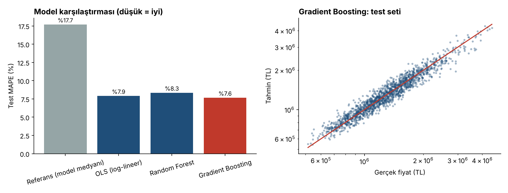
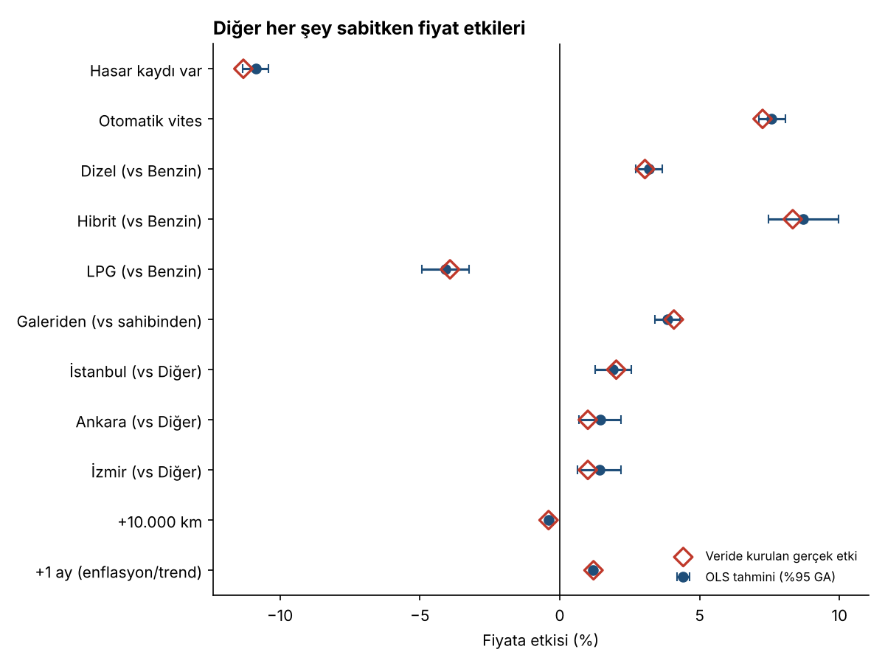
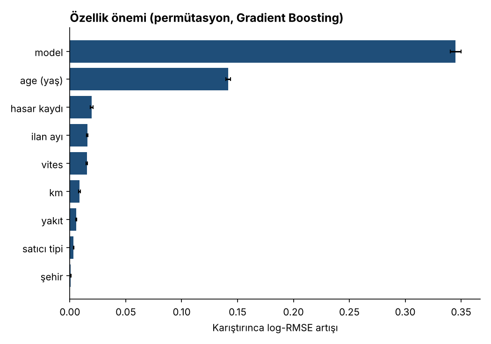
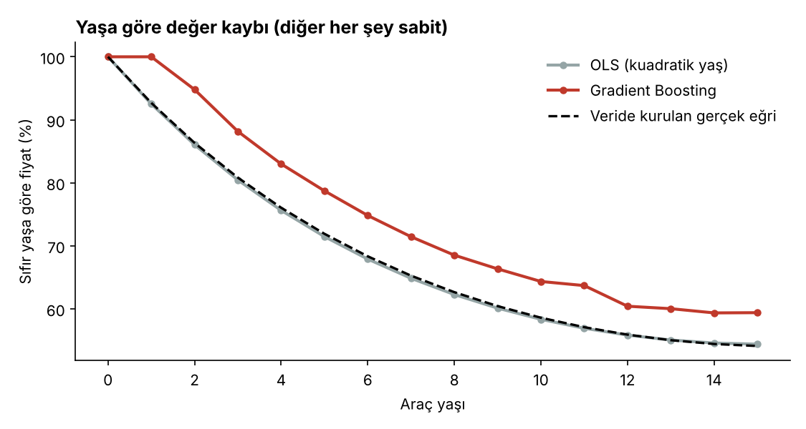

# İkinci El Araç Fiyat Analizi: Yorumlanabilir Regresyon ve Özellik Önemi

İkinci el otomobil ilanlarında fiyatı belirleyen etkenleri iki açıdan inceleyen bir proje: **(1)** "Hasar kaydı fiyatı yüzde kaç düşürüyor?" gibi sorulara cevap veren yorumlanabilir **log-lineer regresyon**, **(2)** tahmin doğruluğu için **Random Forest** ve **Gradient Boosting**. Modeller basit bir referansa ve veriye kurulan gerçek etkilere karşı değerlendirilir.

> **Veri hakkında:** İlanlar `generate_data.py` ile üretilmiş **sentetik** veridir. Fiyatlar kurguseldir, gerçek bir ilan sitesine veya piyasaya dayanmaz; model adları yalnızca gerçekçi etiket olarak kullanılmıştır. Bu yüzden **bulgular piyasa hakkında bilgi vermez, yöntemi gösterir**. Kod, aynı şemada gerçek bir CSV ile de çalışır (aşağıya bakın).

## Soru ve yaklaşım

- 8.000 ilan, 15 model, Kasım 2025 - Ekim 2026 ilan ayları; yaş, km, yakıt, vites, hasar kaydı, satıcı tipi, şehir
- Hedef değişken `log(fiyat)`: katsayılar doğrudan yüzde etki olarak okunur (`exp(b) − 1`)
- Veri, bilinen "gerçek" etkilerle (ör. hasar −%11,3, otomatik vites +%7,3) üretildi. **Böylece regresyonun bu etkileri geri bulup bulamadığı kontrol edilebilir**; gerçek veride bu mümkün olmaz
- Değerlendirme: %80/%20 ayrım (1.600 test ilanı) ve eğitim kümesinde 5-katlı çapraz doğrulama

## Sonuçlar

### 1) Tahmin doğruluğu

| Model | Test MAPE | Test MedAPE | Test MAE (TL) | R² | CV MAPE (5 kat) |
|-------|----------:|------------:|--------------:|---:|----------------:|
| Referans (modelin medyan fiyatı) | %17,7 | %14,6 | 246.801 | 0,64 | %17,6 ± 0,7 |
| OLS (log-lineer) | %7,9 | %6,7 | 112.462 | 0,92 | %7,7 ± 0,1 |
| Random Forest | %8,3 | %6,9 | 116.490 | 0,92 | %8,5 ± 0,2 |
| **Gradient Boosting** | **%7,6** | **%6,4** | **107.006** | **0,93** | %7,7 ± 0,2 |



- Yaş, km, yakıt gibi bilgileri kullanmak hatayı referansın **yarısından fazla** azaltıyor (%17,7 → %7,6).
- **Üç model birbirine çok yakın**, çapraz doğrulamada OLS ile Gradient Boosting aynı (%7,7). Veriye eklenen rastgele gürültü (log fiyatta σ = 0,09) tek başına yaklaşık **%7,2 MAPE** tabanı yaratıyor; yani modeller bu tabanın 0,4-1,1 puan yakınında ve daha fazla iyileşme için bilgi kalmamış.
- Bu sonucun bir nedeni verinin log-lineer bir yapıyla üretilmiş olması. Gerçek ilan verisinde (marka-yaş etkileşimleri, kampanyalar, eksik bilgi) ağaç tabanlı modellerin avantajı büyük olasılıkla artar; bu projede bu **test edilmedi**.

### 2) "Ne kadar etkiliyor?": OLS katsayıları

Diğer her şey sabitken fiyat etkileri ve veriye kurulan gerçek etkiler:

| Değişken | OLS tahmini (%95 GA) | Kurulan gerçek etki |
|----------|---------------------:|--------------------:|
| Hasar kaydı var | −%10,9 (−11,3; −10,4) | −%11,3 |
| Otomatik vites | +%7,6 (7,1; 8,1) | +%7,3 |
| Hibrit (vs benzin) | +%8,7 (7,5; 10,0) | +%8,3 |
| Dizel (vs benzin) | +%3,2 (2,7; 3,7) | +%3,1 |
| LPG (vs benzin) | −%4,1 (−4,9; −3,2) | −%3,9 |
| Galeriden (vs sahibinden) | +%3,9 (3,4; 4,3) | +%4,1 |
| İstanbul (vs diğer şehirler) | +%1,9 (1,3; 2,6) | +%2,0 |
| +10.000 km | −%0,38 (−0,44; −0,32) | −%0,40 |
| +1 ay (fiyat trendi) | +%1,20 (1,13; 1,26) | +%1,21 |

**%95 güven aralıkları kurulan gerçek etkinin 11/11'ini kapsıyor** (tabloda yalnızca bir kısmı gösterilmiştir, tamamı [`results/ols_effects.csv`](results/ols_effects.csv) içinde). Bu, yöntemin ve kodun doğru çalıştığının bir kanıtı: model, bilinen etkileri geri bulabiliyor.



### 3) Hangi değişken ne kadar önemli?

Permütasyon önemi (bir değişkeni karıştırınca log-RMSE ne kadar artıyor, Gradient Boosting, test seti):



Sıralama model (0,345), yaş (0,142), hasar kaydı (0,020), ilan ayı (0,016), vites (0,015), km (0,009). **Hangi model olduğu ve yaş, fiyat farklarının büyük kısmını açıklıyor**; hasar ve vites gibi değişkenler tek tek küçük ama sistematik etkiler. Bu önem değerleri verinin nasıl üretildiğini yansıtır, gerçek piyasaya genellenemez.

### 4) Yaşa göre değer kaybı



OLS'in kuadratik yaş terimi, veriye kurulan gerçek eğriyi yaklaşık 0,5 puan içinde yakalıyor. **Gradient Boosting'in eğrisi ise değer kaybını olduğundan az gösteriyor** (2-12 yaş arasında gerçek eğrinin 4,5-8,5 puan üstünde; sıfırdan bir yaşa kadar da düz). Bunun nedenini bu çalışmada incelemedim; olası açıklamalar yaş ile km'nin birbiriyle ilişkili olması (etkinin bir kısmı km ve model değişkenlerine yayılıyor) ve modelin düzenlileştirilmesi. Çıkarım amacıyla (etki okumak) yorumlanabilir OLS, tahmin amacıyla ağaç modeli kullanmak bu yüzden mantıklı bir iş bölümü.

## Sınırlamalar

- **Sentetik veri:** Tüm sayılar kurgusaldır. Etkilerin büyüklüğü (ör. hasarın −%11'i) veriyi üretirken ben seçtiğim değerlerdir. Projenin değeri sonuçta değil, yöntemde ve doğrulama mantığında.
- **Rastgele ayrım:** Test seti zaman bakımından eğitimle iç içe. Gerçek kullanımda gelecek aylara tahmin için zamana göre ayrım gerekir.
- **Basitleştirmeler:** Motor hacmi, donanım paketi, renk, boya/değişen detayı, ilan metni ve fiyat pazarlığı yok. Hasar kaydı tek bir 0/1 değişkeni.
- **Nedensellik değil ilişki:** Gerçek veride "hasar fiyatı %X düşürür" ifadesi, gözlenmeyen değişkenler yüzünden doğrudan nedensel okunamaz.
- Hiperparametreler elle seçildi, ayrıca aranmadı.

## Kendi verinle çalıştırma

```bash
python run_analysis.py --csv kendi_verim.csv
```

CSV'de şu sütunlar bulunmalı (başka sütunlar yok sayılır). Şemaya uymayan dosyada kod hangi sütunun eksik olduğunu söyleyerek durur. Referans düzeyler (`Benzin`, `Manuel`, `Sahibinden`, `Diğer`) veride yoksa o sütunda alfabetik ilk düzey referans alınır; farklı bir referans için `analysis.CATEGORICAL` sözlüğünü değiştirin:

| Sütun | Açıklama |
|-------|----------|
| `model` | Marka + model (ör. `Toyota Corolla`) |
| `year` | Model yılı |
| `km` | Kilometre |
| `fuel` | Yakıt (`Benzin` referans düzeydir) |
| `gearbox` | Vites (`Manuel` referans) |
| `damage` | Hasar kaydı, 0/1 |
| `seller_type` | Satıcı tipi (`Sahibinden` referans) |
| `city` | Şehir (`Diğer` referans düzeydir) |
| `listing_month` | İlan ayı, `YYYY-MM` |
| `price` | Fiyat, pozitif |

Kendi verinde "kurulan gerçek etki" karşılaştırması otomatik olarak devre dışı kalır.

## Nasıl çalıştırılır

```bash
pip install -r requirements.txt

python generate_data.py                       # data/listings.csv (8.000 ilan)
python -m unittest discover -s tests -v       # 15 birim test
python run_analysis.py                        # modeller, tablolar, grafikler (~30 sn)
```

## Klasör yapısı

```
.
├── generate_data.py     # sentetik ilan üretici (seed = 21), kurulan gerçek etkiler burada
├── analysis.py          # özellik üretimi, OLS (güven aralıklı), metrikler, permütasyon önemi
├── run_analysis.py      # modelleme, doğrulama, grafikler
├── tests/               # 15 birim test
├── data/                # üretilen veri
├── results/             # model karşılaştırması, etkiler, önem, yaş eğrisi, test tahminleri (CSV)
└── images/              # README grafikleri
```
