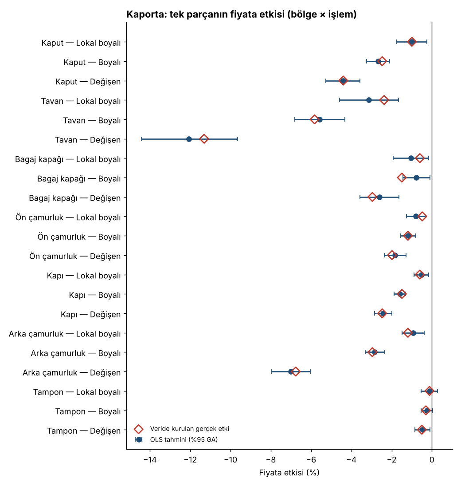
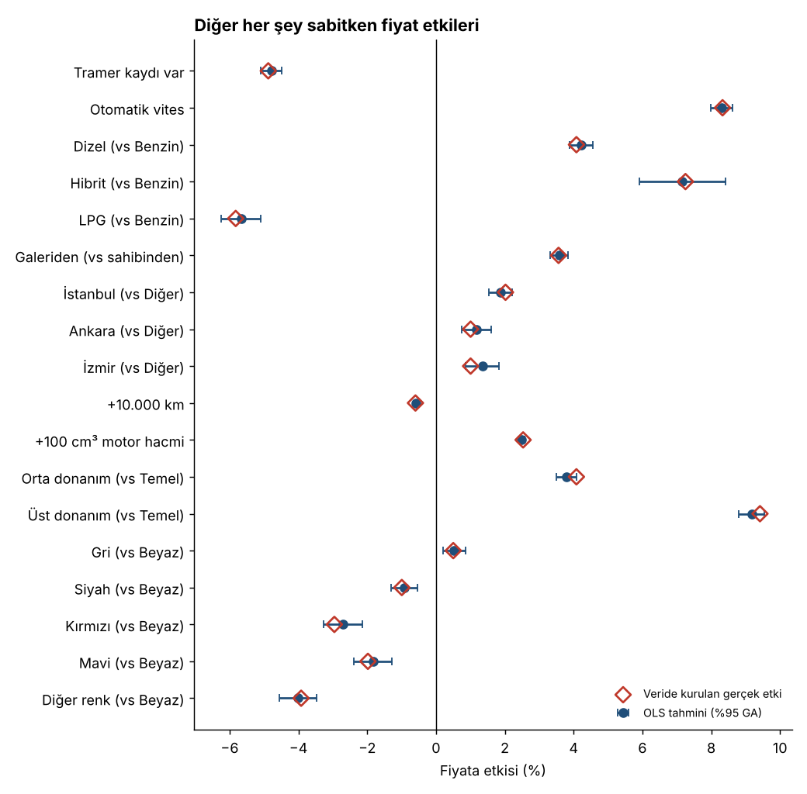
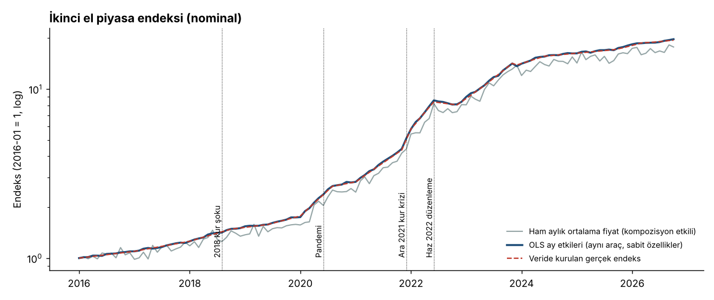
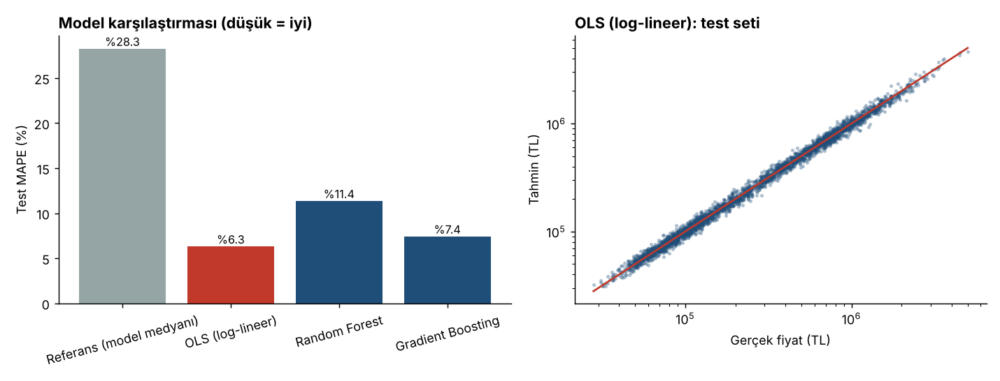
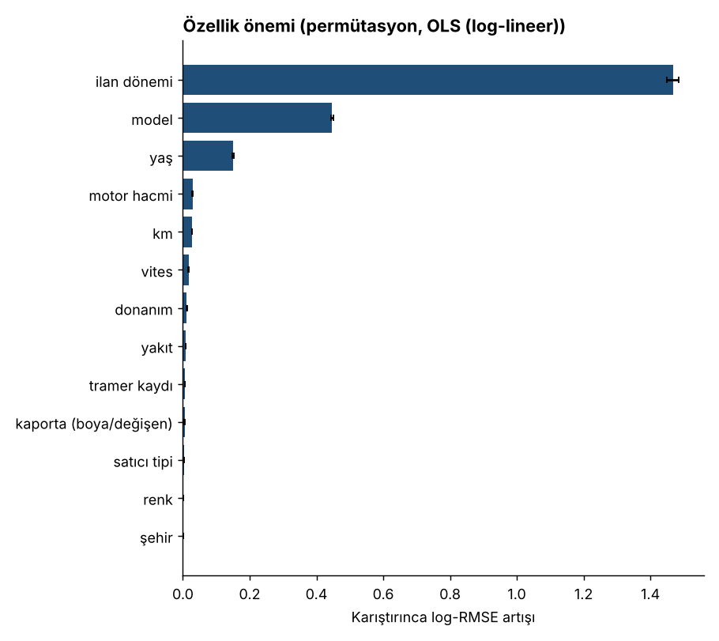
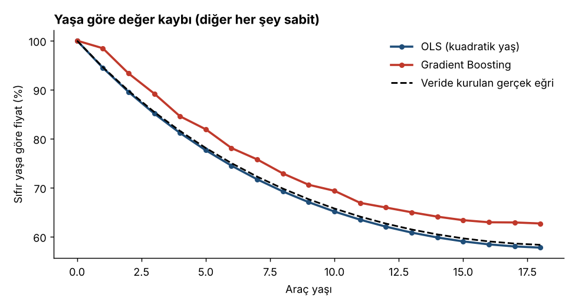

# İkinci El Araç Fiyat Analizi — Türkiye 2016-2026 / Used-Car Price Analysis — Türkiye 2016-2026

**[🇹🇷 Türkçe](#-türkçe)** · **[🇬🇧 English](#-english)**

---

## 🇹🇷 Türkçe

Türkiye ikinci el otomobil piyasasının son 10 yılına (Ocak 2016 - Ekim 2026) kalibre edilmiş 16.000 ilanlık bir veri
setinde, fiyatı belirleyen etkenleri iki açıdan inceleyen bir proje:

1. **Yorumlanabilir log-lineer regresyon (OLS):** "Tavanı değişen araç yüzde kaç değer kaybeder?", "Üst donanım kaç
   puan prim getirir?" gibi sorulara güven aralıklı cevap.
2. **Tahmin modelleri:** Random Forest ve Gradient Boosting, basit bir referansla birlikte karşılaştırılır.

Adım adım anlatım: **[`notebooks/adim_adim_analiz.ipynb`](notebooks/adim_adim_analiz.ipynb)** (çıktılarıyla birlikte).

> **Veri hakkında:** İlanlar `generate_data.py` ile üretilmiş **sentetik** veridir. Genel seviyeler ve dağılımlar
> (ortalama fiyat seyri, renk, yakıt, motor hacmi payları) kamuya açık kaynaklara göre ayarlandı. Ancak tek tek
> ilanlar gerçek değildir ve etkilerin büyüklüğünü (ör. tavan değişimi −%11) biz seçtik. **Bulgular yöntemi gösterir,
> piyasa hakkında kesin bilgi vermez.** Kod, aynı şemada gerçek bir CSV ile de çalışır.

### Bu projede neler gösteriliyor?

- **Veri üretimi ve kalibrasyon:** Kamuya açık kaynaklara (BETAM, TÜİK) göre ayarlanmış, olay bazlı (kur şoku, pandemi, çip krizi) 10 yıllık sentetik veri. Kurulan "gerçek" etkiler sayesinde yöntem doğrulanabiliyor.
- **İstatistiksel modelleme:** Log-lineer OLS (el yazımı, güven aralıklı), aylık dönem kuklalarıyla piyasa endeksi, model bazlı yaş eğimleri, kurulan etkileri geri bulma testi.
- **Makine öğrenmesi:** Random Forest ve Gradient Boosting, zaman ve model etkileşimiyle birlikte; permütasyon önemi.
- **Yazılım pratiği:** 73 birim, tutarlılık ve uçtan uca test; yeniden üretilebilir (seed, `--fast`, CLI); notebook'u üreten betik.
- **Dürüst raporlama:** Sınırlamalar ve doğrulanmamış varsayımlar açıkça yazıldı (aşağıda "Sınırlamalar").

### Veri ve değişkenler

| Grup | Değişkenler |
|------|-------------|
| Araç | 18 model (Fiat Egea, Renault Clio, Toyota Corolla, VW Passat, BMW 3 Serisi …), segment, model yılı, km |
| Motor | yakıt (Benzin / Dizel / LPG / Hibrit), **motor hacmi (cm³)**, vites |
| Donanım | **paket adı** (ör. Joy / Touch / Icon) ve **seviye** (Temel / Orta / Üst) |
| Görünüm | **renk** (Beyaz, Gri, Siyah, Kırmızı, Mavi, Diğer) |
| Kaporta | **13 parça için ekspertiz durumu:** kaput, tavan, bagaj, 4 kapı, 4 çamurluk, 2 tampon → *Orijinal / Lokal boyalı / Boyalı / Değişen*; ayrıca tramer (hasar) kaydı |
| İlan | ilan ayı (2016-01 … 2026-10), satıcı tipi, şehir, fiyat (TL) |

### Kalibrasyon: veri neye göre ayarlandı?

| Konu | Veride | Dayanak |
|------|--------|---------|
| Ortalama ilan fiyatı | 2016: ~85 bin TL → 2026: ~1,16 milyon TL. Aynı araç için piyasa endeksi 10 yılda ~19 kat | BETAM/sahibindex: Kas 2023 **879.146 TL**, Ara 2023 **860.480 TL**, Haz 2024 **968.926 TL**, Eyl 2025 **1,058 M**, Kas 2025 **~1,086 M**, Haz 2026 **~1,175 M** TL. 2022-11 değeri, Kas 2023'teki %76,2 yıllık artıştan geri hesaplandı. **2016-2022 diğer noktalar yaklaşık değerlerdir** (kesin seri bulunamadı): 2018 kur şoku, 2020 pandemi talebi, 2021 çip krizi, Aralık 2021 kur krizi ve Haziran 2022 düzenlemesi sonrası yatay seyir modellendi. |
| Renk | Beyazın payı eski model yıllarında ~%55, yenilerde ~%31. Gri ~%17 → ~%36 | TÜİK trafiğe kayıt verileri: beyaz 2018'de %55,6, 2022'de %39,6. 2026 ilk yarısında gri birinci. Cardata 2018 ikinci el satışları: %44,5 beyaz, %22,7 gri. |
| Yakıt | Dizel payı ~%51 (2017) → ~%44 (2026). Hibrit 2023 sonrası artar. LPG sonradan dönüşüm | Cardata 2018: ikinci el satışlarında dizel %64,5. Sıfır satışlarda elektrikli/hibrit payının hızla artışı (ODD 2025). |
| Motor hacmi | Ağırlık 1.600 cm³ ve altında, 1.600 üstü ~%7 | TÜİK: 2024-2026 kayıtlarında 1.300 cm³ ve altı ~%30-33. ÖTV dilimleri. |
| Yaş dağılımı | Ortalama ilan yaşı ~7,7 (gamma dağılımı, üst sınır 20) | 2025'te el değiştiren motorlu taşıtların ortalama yaşı 11,8 ([NTV](https://www.ntv.com.tr/otomobil/14-yasindaki-otomobilleri-kullaniyoruz-1707683)). Veri bundan daha genç |
| Toyota C-HR taban fiyatı | 2024 model 1.8 hibrit medyanı ~2,15 M TL | Ağustos-Kasım 2026'da ilan sitesinde görülen birkaç 2024 C-HR Passion ilanı (2,07-2,25 M TL). Tek tek ilan ve link depoya alınmadı, yalnızca bu yuvarlanmış aralık kullanıldı. **Diğer 17 modelin taban fiyatı yaklaşık değerdir, ayrıca doğrulanmadı** |
| Kaporta | İlanların ~%27'si "hatasız". Yaşla boya/değişen artar. Tavan en nadir, tampon en sık işlem gören parça | Ekspertiz pratiği. Parça bazlı resmi bir yüzde tablosu yok (aşağıya bakın). |

### Kaporta: hangi parça ne kadar değer kaybettiriyor?

Her bölge ve işlem için tek parçanın fiyata etkisi. Değerler OLS tahminidir, parantez içinde veriye kurulan gerçek
değer var. 4 kapı ve 4 çamurluk, analizde bölge olarak birleştirilir.

| Bölge | Lokal boyalı | Boyalı | Değişen |
|-------|------------:|-------:|--------:|
| **Tavan** | −%3,1 (−2,4) | −%5,6 (−5,8) | **−%12,1 (−11,3)** |
| **Arka çamurluk** (kaynaklı) | −%0,9 (−1,2) | −%2,8 (−3,0) | −%7,0 (−6,8) |
| **Kaput** | −%1,0 (−1,0) | −%2,7 (−2,5) | −%4,4 (−4,4) |
| Bagaj kapağı | −%1,1 (−0,6) | −%0,8 (−1,5) | −%2,6 (−3,0) |
| Ön çamurluk (cıvatalı) | −%0,8 (−0,5) | −%1,2 (−1,2) | −%1,8 (−2,0) |
| Kapı | −%0,5 (−0,6) | −%1,6 (−1,5) | −%2,4 (−2,5) |
| Tampon (plastik) | −%0,1 (−0,1) | −%0,3 (−0,3) | −%0,5 (−0,5) |



**21 kaporta etkisinin 20'si** %95 güven aralığı içinde geri bulundu (kaçan: boyalı bagaj kapağı, sınırda). Etkilerin sıralaması (tavan > arka
çamurluk > kaput > … > tampon) ekspertiz pratiğini izler: tavan ve kaynaklı parçalar yapısal hasar şüphesi
doğurur, cıvatalı çamurluk ve plastik tampon az önemsenir. Büyüklükler, hukuk sitelerindeki değer kaybı
tablolarındaki aralıklarla (ör. kapı değişimi %5-12) aynı mertebede tutuldu, ama **parça bazlı resmi bir oran
yoktur**. Tramer kaydı, bu etkilere **ek olarak** yaklaşık −%5 getirir.

Notebook'ta örnek bir ekspertiz raporu TL'ye çevrilir: 1,2 milyon TL'lik hatasız araçta tavan boyalı, sol arka
çamurluk değişen, iki kapı boyalı ve ön tampon değişen ise toplam kayıp **≈ −%15 (≈ 185 bin TL)** çıkar
(`analysis.body_loss_breakdown`).

### Sonuçlar

#### 1) Diğer her şey sabitken etkiler (OLS)

| Değişken | OLS tahmini (%95 GA) | Kurulan gerçek etki |
|----------|---------------------:|--------------------:|
| Üst donanım (vs temel) | +%9,5 (9,1; 9,9) | +%9,4 |
| Otomatik vites | +%8,2 (7,9; 8,6) | +%8,3 |
| Hibrit (vs benzin) | +%6,8 (5,4; 8,2) | +%7,3 |
| Dizel (vs benzin) | +%4,2 (3,9; 4,5) | +%4,1 |
| Orta donanım (vs temel) | +%4,3 (4,0; 4,6) | +%4,1 |
| Galeriden (vs sahibinden) | +%3,7 (3,5; 4,0) | +%3,6 |
| +100 cm³ motor hacmi (aynı model) | +%2,5 (2,4; 2,6) | +%2,5 |
| Gri (vs beyaz) | +%0,1 (−0,2; 0,5) | +%0,5 (**GA dışında**) |
| +10.000 km | −%0,6 (−0,6; −0,6) | −%0,6 |
| Kırmızı (vs beyaz) | −%3,1 (−3,7; −2,5) | −%3,0 |
| Diğer renk (vs beyaz) | −%3,8 (−4,3; −3,3) | −%3,9 |
| Tramer kaydı var | −%5,0 (−5,3; −4,7) | −%4,9 |
| LPG (vs benzin) | −%5,6 (−6,1; −5,0) | −%5,8 |

**Genel etkiler ve kaporta etkileri dahil 39 katsayının 37'sinde** %95 güven aralığı kurulan gerçek değeri kapsıyor (%95 aralıkta ~2 kaçırma beklenir; kaçanlar gri renk ve boyalı bagaj kapağı, ikisi de sınırda)
(tamamı: [`results/ols_effects.csv`](results/ols_effects.csv), [`results/body_part_effects.csv`](results/body_part_effects.csv)).
Bunun için iki model tercihi önemli:

- **Aylık dönem kuklaları:** Fiyat seviyesi 10 yılda ~20 kat ve doğrusal olmayan biçimde değişti. Tek bir "ay" eğimi
  yerine her ay için bir kukla değişken, OLS'e bir piyasa endeksi kestirtir.
- **Model bazlı yaş eğimi:** Markalar farklı hızda değer kaybeder. Bu etkileşim olmadan hibrit (Toyota/Honda'da
  yoğun) ve LPG katsayıları yanlı çıkıp güven aralığının dışında kalıyordu.



#### 2) Piyasa endeksi



OLS'in ay etkileri, kurulan gerçek endeksi ortalama **1,2 log-puan** (en çok 3,1) farkla izliyor. Ham aylık ortalama
fiyat ise o ay ilana çıkan araçların karışımına bağlı olarak gürültülü. 2021 sonu - 2022 ortası patlaması ve
Haziran 2022 düzenlemesi sonrası gevşeme net görünüyor.

#### 3) Markaya göre yıllık değer kaybı

OLS'e göre en az değer kaybedenler Honda Civic ve Toyota Corolla (~%6,1/yıl), en çok kaybedenler BMW 3 Serisi ve
Mercedes C Serisi (~%10/yıl). Kurulan değerler 6,1 ve 10,0 ([`results/model_depreciation.csv`](results/model_depreciation.csv)).

#### 4) Tahmin doğruluğu

| Model | Test MAPE | Test MedAPE | Test MAE (TL) | R² | CV MAPE (5 kat) |
|-------|----------:|------------:|--------------:|---:|----------------:|
| Referans (aynı model + ilan yılı medyanı) | %28,3 | %22,6 | 140.950 | 0,71 | %27,7 ± 0,4 |
| **OLS (log-lineer)** | **%6,3** | **%5,2** | **29.025** | **0,99** | **%6,5 ± 0,1** |
| Random Forest | %11,4 | %8,7 | 57.105 | 0,94 | %12,3 ± 0,2 |
| Gradient Boosting | %7,5 | %6,1 | 35.608 | 0,98 | %8,0 ± 0,2 |



- Bu veride **OLS en iyisi**, çünkü veri log-lineer bir yapıyla üretildi ve OLS doğru kuruldu. Gürültü tabanı
  (log fiyatta σ = 0,08) tek başına ~%6,4 MAPE demek; OLS bu tabanla aynı düzeyde.
- Random Forest geride kalıyor. Fiyat seviyesi 10 yılda 20 kat değişince, ağaçların sayısal "ay sırası" üzerinden
  bu trendi basamak basamak öğrenmesi gerekiyor.
- Gerçek ilan verisinde (etkileşimler, kampanyalar, eksik bilgi) ağaç modellerinin göreli avantajı büyük olasılıkla
  artar. Bu projede **test edilmedi**.

#### 5) Özellik önemi ve yaş eğrisi



Fiyat farklarının çoğunu **ilan dönemi** (enflasyon), **model** ve **yaş** açıklıyor. Kaporta, ortalamada küçük
görünüyor çünkü ilanların yalnızca bir kısmında ciddi işlem var. Ama işlem görmüş tek bir araç için %10'un üzerinde
fark yaratabiliyor.



OLS'in yaş eğrisi kurulan eğriyi neredeyse tam yakalıyor (10 yaşında %52,2 / gerçek %52,3). Gradient Boosting'in
eğrisi daha düz (10 yaşında %57,3). Bir nedeni, 2021-2022 çip krizinde 0-1 yaşındaki araçlara kurulan +%6'lık prim:
bu etkileşimi OLS'e bilerek koymadık, ağaç modeli ise kısmen yakalıyor.

### Sınırlamalar

- **Sentetik veri:** Etki büyüklükleri bizim seçimimiz. 2016-2022 fiyat çapaları yaklaşık. 2016 başındaki üretilen
  ortalama çapadan ~%31, Kasım 2023'te ~%12 yüksek (2024 sonrası ±%3). Model yılı bazında üretilen ortalamalar BETAM'ın
  Eylül 2025 değerlerinin yaklaşık %10-15 altında (karışım farkı payı belirsiz). **Yalnızca Toyota C-HR gerçek ilanlarla
  doğrulandı, diğer 17 modelin fiyat düzeyi doğrulanmadı.** Bu proje yöntemi gösterir, fiyat vermez.
- Elektrikli araçlar (Togg, Tesla …), ağır hasar / pert kaydı, ilan metni ve pazarlık payı yok.
- Rastgele eğitim/test ayrımı. Geleceğe tahmin için zamana göre ayrım gerekir.
- **Nedensellik değil ilişki:** Gerçek veride "boya fiyatı %X düşürür" ifadesi nedensel okunamaz. Boyalı araçlar
  başka açılardan da (bakım, kullanım yoğunluğu) farklı olabilir.
- Hiperparametreler elle seçildi, ayrıca aranmadı.

### Kendi verinle çalıştırma

```bash
python run_analysis.py --csv kendi_verim.csv
```

Zorunlu sütunlar: `model`, `year`, `km`, `fuel` (`Benzin` referans), `gearbox` (`Manuel`), `damage` (0/1),
`seller_type` (`Sahibinden`), `city` (`Diğer`), `listing_month` (`YYYY-MM`), `price` (> 0).

İsteğe bağlı sütunlar (varsa modele girer): `color` (`Beyaz` referans), `engine_cc`, `trim_level`
(`Temel`/`Orta`/`Üst`) ve 13 kaporta sütunu (`kaput`, `tavan`, `bagaj`, `sol_on_camurluk`, `sag_on_camurluk`,
`sol_on_kapi`, `sag_on_kapi`, `sol_arka_kapi`, `sag_arka_kapi`, `sol_arka_camurluk`, `sag_arka_camurluk`,
`on_tampon`, `arka_tampon`). Kaporta sütunlarının değerleri *Orijinal / Lokal boyalı / Boyalı / Değişen*
olmalıdır.

Şemaya uymayan dosyada kod, hangi sütunun eksik ya da hatalı olduğunu söyleyerek durur. Kendi verinde "kurulan
gerçek etki" karşılaştırması otomatik olarak kapanır.

### Nasıl çalıştırılır

```bash
pip install -r requirements.txt
```

```bash
python generate_data.py                       # data/listings.csv (16.000 ilan, seed = 21)
```

```bash
python -m unittest discover -s tests -v       # 73 test (~20 sn)
```

```bash
python run_analysis.py                        # modeller, tablolar, grafikler (~40 sn)
```

```bash
python notebooks/build_notebook.py            # notebook'u üretir ve çalıştırır
```

### Klasör yapısı

```
.
├── generate_data.py      # kalibre sentetik veri üretici: piyasa endeksi, model kataloğu, kurulan etkiler, kaporta cezaları
├── analysis.py           # şema, özellik üretimi, OLS (güven aralıklı), kaporta etkileri, metrikler, permütasyon önemi
├── run_analysis.py       # modelleme, doğrulama, grafikler (--fast, --csv, --results-dir, --images-dir)
├── notebooks/            # adım adım anlatım (adim_adim_analiz.ipynb) ve onu üreten betik
├── tests/                # 73 test: analiz birimleri, veri tutarlılığı/kalibrasyon, uçtan uca hat
├── data/                 # üretilen veri
├── results/              # model karşılaştırması, etkiler, kaporta, endeks, değer kaybı, önem, tahminler (CSV)
└── images/               # README grafikleri
```

### Kaynaklar

- BETAM / sahibindex Otomobil Piyasası Görünümü: [Aralık 2023](https://betam.bahcesehir.edu.tr/2023/12/sahibindex-otomobil-piyasasi-gorunumu/), [Kasım 2025](https://betam.bahcesehir.edu.tr/2025/11/sahibindex-otomobil-piyasasi-gorunumu-kasim-2025/), [Haziran 2026](https://betam.bahcesehir.edu.tr/2026/06/sahibindex-otomobil-piyasasi-gorunumu-haziran-2026/)
- Haziran 2024 ortalaması ve reel düşüş: [Karar](https://www.karar.com/ekonomi-haberleri/sahibinden-raporu-aciklandi-ortalama-fiyat-artti-degerler-dustu-1978022) · Eylül 2025 ortalaması: [Webtekno](https://www.webtekno.com/turkiye-ortalama-ikinci-el-otomobil-fiyatlari-h205519.html) · fiyat artışı ve enflasyon: [Ekonomim](https://www.ekonomim.com/sektorler/otomotiv/ikinci-el-otomobilde-dikkat-ceken-tablo-fiyat-artisi-enflasyonun-altinda-kaldi-haberi-910738)
- Renk: [GZT (TÜİK 2026 ilk yarı)](https://www.gzt.com/teknoloji/turkiyede-otomobil-tercihinde-gri-ve-beyaz-one-cikti-4244692), [Capital (beyaz payının düşüşü)](https://www.capital.com.tr/haberler/tum-haberler/otomobilde-beyaz-renk-tercihi-degisti), [Milliyet (Cardata 2018 ikinci el)](https://www.milliyet.com.tr/ekonomi/ikinci-elde-de-tercih-degismedi-2862211)
- Motor hacmi (TÜİK aylık bültenleri): [CNN Türk](https://www.cnnturk.com/ekonomi/tuik-kasimda-122-bin-837-tasitin-trafige-kaydi-yapildi), [Araclo](https://www.araclo.com/trafik-silindir-hacmi-raporu)
- Pazar payları ve araç parkı yaşı: [Best Selling Cars Blog (2025)](https://bestsellingcarsblog.com/2026/01/turkiye-full-year-2025-renault-and-clio-take-the-lead-in-record-market/), [NTV](https://www.ntv.com.tr/otomobil/14-yasindaki-otomobilleri-kullaniyoruz-1707683)
- Boya/değişen ve değer kaybı: [arabam.com blog](https://www.arabam.com/blog/?p=74382), [Fair Fix (kapı hasarı)](https://fairfix.com.tr/parca-deger-kaybi/kapi-hasarinda-arac-deger-kaybi-hesaplama-orta/), [Koptay Hukuk (hesaplama yöntemi)](https://koptay.av.tr/makale/arac-deger-kaybi-hesaplama-yontemi-kriterleri)

### Lisans ve marka notu

Bu depo yalnızca **incelenmek için** herkese açıktır; kodun, verinin veya notebook'un başka bir yerde kullanılması için yazılı izin gerekir ([LICENSE](LICENSE)). Marka ve model adları ilgili sahiplerine aittir; bu proje onlarla bağlantılı değildir, adlar yalnızca etiket olarak kullanılmıştır.

---

## 🇬🇧 English

A project that studies what drives used-car prices, on a 16,000-listing dataset calibrated to the last ten years
of Türkiye's used-car market (January 2016 - October 2026). It looks at prices from two angles:

1. **Interpretable log-linear regression (OLS):** answers questions like "how much value does a car lose if its roof
   was replaced?" or "what premium does the top trim earn?", with confidence intervals.
2. **Predictive models:** Random Forest and Gradient Boosting, compared against a simple baseline.

Step-by-step walkthrough: **[`notebooks/adim_adim_analiz.ipynb`](notebooks/adim_adim_analiz.ipynb)** (executed, in
Turkish with English headings in this README).

> **About the data:** The listings are **synthetic**, generated by `generate_data.py`. Overall levels and
> distributions (average price path, colour, fuel and engine-size shares) are calibrated to public sources. Individual
> listings are not real, and effect sizes (e.g. −11% for a replaced roof) were chosen by us. **The findings
> demonstrate the method; they are not authoritative market facts.** The code also runs on a real CSV with the same
> schema.

### What this project demonstrates

- **Data generation and calibration:** a 10-year synthetic dataset tuned to public sources (BETAM, TÜİK) with event-based dynamics (currency shock, pandemic, chip shortage). Planted "true" effects make the method verifiable.
- **Statistical modelling:** hand-written log-linear OLS with confidence intervals, a market index from monthly period dummies, model-specific age slopes, and a planted-effect recovery test.
- **Machine learning:** Random Forest and Gradient Boosting, with permutation importance.
- **Engineering practice:** 73 unit, consistency and end-to-end tests; reproducible (seeds, `--fast`, CLI); a script that builds the notebook.
- **Honest reporting:** limitations and unverified assumptions are stated explicitly (see "Limitations").

### Data and variables

| Group | Variables |
|-------|-----------|
| Car | 18 models (Fiat Egea, Renault Clio, Toyota Corolla, VW Passat, BMW 3 Series …), segment, model year, mileage |
| Powertrain | fuel (petrol / diesel / LPG / hybrid), **engine size (cc)**, gearbox |
| Trim | **package name** (e.g. Joy / Touch / Icon) and **level** (base / mid / top) |
| Appearance | **colour** (white, grey, black, red, blue, other) |
| Bodywork | **inspection status of 13 panels:** bonnet, roof, boot lid, 4 doors, 4 wings, 2 bumpers → *original / spot-painted / painted / replaced*; plus an insurance damage record (*tramer*) |
| Listing | listing month (2016-01 … 2026-10), seller type, city, price (TRY) |

### Calibration

- **Average listing price:** follows anchor points. From late 2023 onward these are BETAM/sahibindex monthly
  averages (Nov 2023: TRY 879,146; Jun 2024: TRY 968,926; Nov 2025: ~TRY 1.086 M; Jun 2026: ~TRY 1.175 M).
  **The 2016-2022 anchors are approximate** (no exact series was found). The Toyota C-HR base price was set so a 2024 1.8 hybrid lands at ~TRY 2.15 M, the range seen in a handful of public listings in Aug-Nov 2026 (no individual listing or link is stored). **The other 17 models' base prices are approximate and unverified.** They model the 2018 currency shock, pandemic
  demand in 2020, the 2021 chip shortage, the December 2021 currency crisis and the plateau after the June 2022
  dealer regulation. The like-for-like market index rises ~19× over the decade.
- **Colour:** white falls from ~55% (older model years) to ~31% while grey rises from ~17% to ~36%, matching TÜİK registration
  data and a 2018 Cardata used-sales study.
- **Fuel:** diesel share drops from ~51% to ~44%, hybrids grow after 2023, and LPG is modelled as an aftermarket
  conversion of petrol cars.
- **Engine size:** mostly ≤1,600 cc, reflecting Türkiye's engine-size-based special consumption tax brackets.
- **Bodywork:** ~27% of listings are "clean" (no paint or replaced panels). Bodywork increases with age; the roof is
  the rarest panel to be touched and bumpers the most common.

### Bodywork: how much value does each panel cost?

The table shows the price effect of a single panel by region and treatment. Values are OLS estimates; the planted
true value is in brackets.

| Region | Spot-painted | Painted | Replaced |
|--------|------------:|--------:|---------:|
| **Roof** | −3.1% (−2.4) | −5.6% (−5.8) | **−12.1% (−11.3)** |
| **Rear wing** (welded) | −0.9% (−1.2) | −2.8% (−3.0) | −7.0% (−6.8) |
| **Bonnet** | −1.0% (−1.0) | −2.7% (−2.5) | −4.4% (−4.4) |
| Boot lid | −1.1% (−0.6) | −0.8% (−1.5) | −2.6% (−3.0) |
| Front wing (bolted) | −0.8% (−0.5) | −1.2% (−1.2) | −1.8% (−2.0) |
| Door | −0.5% (−0.6) | −1.6% (−1.5) | −2.4% (−2.5) |
| Bumper (plastic) | −0.1% (−0.1) | −0.3% (−0.3) | −0.5% (−0.5) |

**20 of 21** bodywork effects are recovered within their 95% confidence intervals (the miss, painted boot lid, is borderline).

The ordering (roof > welded rear wing > bonnet > … > bumper) follows Turkish inspection practice: roof and welded
panels suggest structural damage, while bolted wings and plastic bumpers matter little. Magnitudes sit in the same
range as published diminished-value tables (e.g. 5-12% for a replaced door), but **no official per-panel table
exists**. An insurance damage record costs a further ~5% on top of these effects.

The notebook turns an example inspection report into TRY: roof painted, rear wing replaced, two doors painted and
front bumper replaced. On a clean-condition price of TRY 1.2 M, the total loss is **≈ −15% (≈ TRY 185k)**
(`analysis.body_loss_breakdown`).

### Results

- **Holding everything else constant (OLS):** top trim **+9.5%**, automatic **+8.2%**, hybrid **+6.8%**, diesel
  **+4.2%**, +100 cc **+2.5%**, dealer vs private seller **+3.7%**, red vs white **−3.1%**, damage record **−5.0%**,
  LPG **−5.6%**. **37 of 39** planted coefficients (general + bodywork) fall inside the 95% CIs (about 2 misses are
  expected at 95%; here grey colour and painted boot lid, both borderline). Two modelling choices matter:
  - **Monthly period dummies:** the price level moved ~20× non-linearly over the decade, so one dummy per month
    replaces a single time slope.
  - **Model-specific age slopes:** brands depreciate at different rates. Without this interaction, the hybrid and LPG
    coefficients were biased.
- **Market index:** the OLS month effects track the planted index within **1.2 log points** on average (max 3.1).
  The raw monthly mean is noisy because it depends on which cars were listed that month.
- **Depreciation by model:** Honda Civic and Toyota Corolla lose ~6.1% a year; BMW 3 Series and Mercedes C-Class
  lose ~10% a year (planted: 6.1 and 10.0).
- **Prediction (test MAPE):**

  | Model | Test MAPE |
  |-------|----------:|
  | Baseline (model + listing-year median) | 28.3% |
  | **OLS** | **6.3%** |
  | Random Forest | 11.4% |
  | Gradient Boosting | 7.5% |

  OLS wins here because the data is log-linear by construction, and the noise floor alone is ~6.4% MAPE. Random
  Forest struggles to learn a 20× trend from a numeric month index. Tree models would likely gain on real listings
  with interactions and missing information, but this was **not tested**.
- **Importance:** listing period (inflation), model and age explain most of the variation. Bodywork looks small on
  average because few cars have serious work, but it moves an affected car's price by more than 10%.
- **Age curve:** OLS matches the planted curve almost exactly (52.2% vs 52.3% at age 10). Gradient Boosting is
  flatter (57.3%). One reason is the planted +6% chip-shortage premium for 0-1-year-old cars in 2021-2022, which OLS
  deliberately omits.

### Limitations

- **Synthetic data:** we chose the effect sizes, and the 2016-2022 price anchors are approximate. The generated
  average is ~31% above its anchor in early 2016 and ~12% in Nov 2023 (within ±3% from 2024). Model-year averages sit
  roughly 10-15% below BETAM's Sep 2025 figures (how much is mix is unclear). **Only the Toyota C-HR was checked
  against real listings; the price level of the other 17 models was not.** The project demonstrates the method; it
  does not produce prices.
- No electric vehicles, write-off records, listing text or negotiation margin.
- Random train/test split; forecasting future months would need a time-based split.
- **Association, not causation:** on real data, "paint lowers price by X%" cannot be read causally.
- Hyperparameters were set by hand, not tuned.

### Run it

```bash
pip install -r requirements.txt
```

```bash
python generate_data.py                       # data/listings.csv (16,000 listings, seed = 21)
```

```bash
python -m unittest discover -s tests -v       # 73 tests (~20 s)
```

```bash
python run_analysis.py                        # models, tables, charts (~40 s)
```

```bash
python run_analysis.py --csv my_data.csv      # your own data (schema above / analysis.REQUIRED)
```

```bash
python notebooks/build_notebook.py            # build and execute the notebook
```

Sources are listed in the Turkish section under **Kaynaklar**.

### License and trademark note

This repository is public **for viewing only**; using the code, data or notebook elsewhere requires written permission ([LICENSE](LICENSE)). Brand and model names belong to their respective owners; this project is not affiliated with them and the names are used only as labels.
